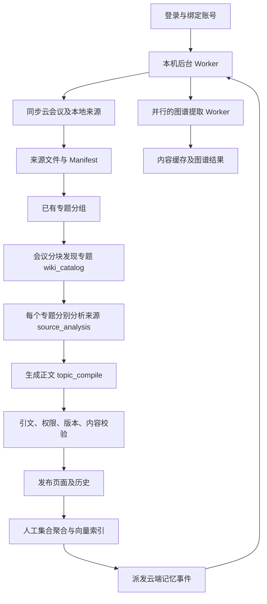

# 知识库整理架构审计

审计日期：2026-11-05。范围为当前 Desktop 源码、必要的本机状态计数，以及 Lynclaw synthesis 请求幂等实现。本文区分已在本地修复的缺陷和仍需改造的架构问题；不代表客户端已经更新或线上已完成验证。

后续实施：用户已授权完成全部待改造项，本轮代码修复与迁移已落实。下文问题触发条件保留为改造前审计快照；当前行为以 [增量整理与恢复约定](knowledge-wiki-incremental.md)、[来源恢复约定](knowledge-source-recovery.md) 和 [实施任务](../specs/knowledge-incremental-repair/tasks.md) 为准。尚未部署或替换安装中的客户端。

## 结论

现有来源授权、引文校验、专题历史和内容缓存值得保留。主要问题是：系统虽然有多层缓存，调度、任务完成、文件提交和失败恢复没有统一的持久任务模型。因此“有缓存”不能保证“启动后只处理增量”，也不能保证异常退出后准确续跑。

不建议推倒重写。先修重复触发与状态覆盖，再把增量身份、任务回执和存储提交收口。不能仅在应用启动时跳过整理，否则会漏掉新增资料、尚未完成的工作和授权变化。

## 当前链路

- Worker 在启动时立即运行，随后每 120 秒或前台/网络恢复时唤醒。触发检查本身合理；是否有实际工作应由持久输入版本决定。
- 分组目前发生在正文整理之前，新发布专题通常要等下一轮才进入分组。
- 同步主循环会等待整轮 Wiki 编译及记忆事件派发，因此大量积压工作会推迟下一轮来源发现。
- 图谱与 Wiki 共用有界模型队列，但图谱、正文、分组和云端事件各自保存完成状态。

主要文件：`workbench/mod.rs::start_worker`、`sync.rs::run`、`wiki.rs::run`、`wiki_automation.rs::run`、`wiki_hierarchy.rs::run`。

## 状态与存储

| 存储 | 保存内容 | 当前边界问题 |
| --- | --- | --- |
| `Meetings/<scope>/*.md` 与 `*.source.json` | 可读原文与结构化来源 | 两个文件和 Manifest 分别提交，不能保证整体原子性 |
| 原生 `workbench/<scope>/state.json`、`derived.json` | 来源索引、授权镜像、整理进度、上传/事件回执 | 不同功能共享整份状态，提交锁曾不一致；单一 phase 同时表达多个任务 |
| `wiki/topics.json`、专题 `published.*`、`revisions/` | 专题身份、人工决定、正文、历史 | 同一页多份数据分步写；所有专题及历史集中在大 JSON 中 |
| `automatic-catalog.json` | 来源归类结果、失败、身份映射 | 能复用成功结果，但缺少完整的持久任务生命周期与删除墓碑 |
| `index.sqlite/jobs` | 分析/编译成功回执 | `running` 不是有租约的持久执行声明；重启后的未知结果缺少统一恢复规则 |
| 图谱与分组 JSON | 块缓存、处理中/失败/人工状态 | 图谱和分组已有更明确的未知结果保护，正文管线没有统一采用 |

`scope` 由服务与已验证账号共同决定。其他账号或服务范围中的历史成果不能直接当作当前账号的缓存使用。

## 本次已在本地修复

1. **自动整理误用手动完成判断。** 自动页保存 `page_version`，入口却比较手动整理的全库 `fingerprint`，已完成任务一直被视为待处理。现在使用自动整理自己的输入判断，并保存本轮实际处理的快照，避免把运行中才到来的新输入标成已处理。
2. **全部缓存分块仍进入任务波次。** 过去每块都会读取、回放、保存全部专题并显示分析进度。现在缓存关联在内存中统一恢复，只有未命中的分块进入分析队列。
3. **进度与集合的收尾缺失。** 新的增量短路需要同时处理分组完成后的进度归一，以及人工集合成员排除、删除和编辑后的聚合唤醒，避免卡在“分组中”或漏更新集合。
4. **排除来源死锁。** `workbench_exclude` 持有全局提交锁后又调用需要同一把锁的云策略更新。现在先保存本地决定、释放锁，再更新云策略。
5. **云上传/事件回执覆盖并发状态。** 原实现可能在网络等待后保存旧 Manifest，覆盖期间新增的来源、进度或策略。提交改为锁内重新读取最新状态、校验会话和来源，再合并对应回执；手动上传入口不再持锁跨全部网络请求。
6. **同波次的成功结果被错误丢弃。** 并发请求全部结束后，遇到第一个服务错误就提前返回，后面的成功结果没有提交。现在先保存同波次的其他成功结果，再停止后续波次。
7. **旧缓存迁移反复写盘。** 已完成当前版本的页面跳过旧页面校验，仅在采用旧回执、恢复关联或更新身份时保存。
8. **本地 AI 否决需要在原生读取出口生效。** 云端资格允许不能覆盖本机的禁止 AI、排除、冲突或敏感资料限制。原生过滤出口与 MCP 的本地敏感性检查统一按更严格的本地决定拒绝，并在云授权返回后复核。

对应实现集中在 `wiki_automation.rs`、`knowledge_cloud.rs`、`mod.rs`。相关回归覆盖重载后跳过、只更新受影响专题、缓存关联保留、失败不形成轮询重试、集合成员变化以及分组进度收尾。

## 改造前发现的问题（本轮已落实修复）

本节保留当时的证据与触发条件，不表示相同缺陷仍存在于当前源码。模型任务账本、来源/页面日志、增量 outbox、稳定分块与编译批次、删除墓碑、模型版本发现、来源倒排图谱及独立内容刷新版本均已实现，并增加对应回归。

### P1：冲突分支可能进入无法恢复的状态

`store.rs::read_document` 检测用户编辑后返回错误；`sync.rs::run` 将来源标记为 `conflict` 后继续，却没有生成完整的 `incoming.json`。`workbench_resolve_conflict` 又必须读取这个文件。后续同步在 `cached_meeting` 看到 conflict 就立即退出，手动刷新也不能绕过，因而用户编辑一次 Markdown 就可能使来源长期停止更新。

应把真正的外部编辑与内部提交中断分开处理。冲突必须生成可供用户选择的完整本地/远端版本；缺少 incoming 文件的历史冲突也应能安全补齐。

### P1：单文件原子写不足以保证一次完整发布

来源依次写 `source.json`、Markdown、Manifest。专题依次写 revision 快照、`published.md`、`published.json`，最后再写 `topics.json`。中途退出可能得到“新正文 + 旧完成指纹”。重启后 `topics()` 把磁盘 Markdown 放入旧页面元数据，哈希不符又被当成用户编辑保护，后续编译持续跳过。

应采用版本目录/不可变快照加单一 head 指针，或将权威结构化状态纳入同一 SQLite 事务。Markdown 是可编辑的导出与覆盖层；启动时先对账内部未完成提交，再判断是否为用户编辑。不要简单忽略哈希差异或覆盖文件。

### P1：正文任务缺少跨重启的稳定执行身份

`wiki.rs::request_model_report` 每次生成新的 `operationId`；`cached_compilation` 只复用 `jobs.state='done'`，不会用旧 `running` 回执确认远端是否已完成。后端确实按 operationId 做执行去重，但客户端重启后的新 UUID 代表另一任务。因此网络超时/进程退出后，同一逻辑输入仍可能再次请求模型。

应从账号、任务类型、有效输入指纹和协议版本生成稳定任务 ID，持久保存尝试与远端回执。未知结果先查询/恢复，明确失败再重试。这里能证明存在重复模型调用及供应商成本风险，不能据此断言用户被重复扣费。

### P1：云端记忆派发仍是全量扫描，并阻塞来源主循环

`publish_memory_events` 每轮扫描并验证所有可用专题。开启 `memory_consent` 后，`knowledge_cloud.rs::publish_events` 对每个专题先调用 `/sources/sync`，再比较事件是否已经发布。一个已有数百专题、没有内容变化的库仍可能每轮顺序执行数百次来源同步请求，同一来源还会被多个专题重复同步。

应先形成持久 outbox，收集本轮真正变化的页面；来源版本按去重后的 ID 批量同步。事件派发使用独立、有界、低优先级队列，保留当前授权和来源版本复核，不阻塞来源发现。

### P2：内容版本与元数据、权限版本混用

`Document::refresh_revision` 对整份 Document 哈希，自动 `input_key` 又包含这个 revision。会议从已选文件夹 A 移到同样已选的 B，或者仅更新时间、标签、播放路径发生变化，也能使正文未变的来源重新归类。使用摘要时仍继承原文档 revision，因此原转写/待办变化也可能使不变摘要重新处理。

此外，云列表原始行与原始待办数组也参与远程版本，计数及数组顺序变化可能造成额外下载。

应拆分 `content_revision`、`metadata_revision`、`policy_revision`。内容缓存按实际发送的规范化输入寻址；引用在授权仍有效时重新绑定当前来源版本并校验。不能只从缓存键删除 revision，否则会复用过期引用。

模型身份也需要拆开：当前 `text_revision` 直接包含 `model_override`，而该对象可带 `apiKey`，因此只轮换同模型密钥也会全量失效。使用服务默认模型时 `model_override=null`，又缺少服务实际处理器版本。缓存应排除密钥，明确包含模型、提示词、schema 与隐私规则版本。

### P2：删除没有形成持久的禁止重建决定

`topic_store::delete` 删除专题与文件，但 catalog 回执和身份映射仍保留。下一次合法增量整理回放这些回执时，`apply_catalog` 会重新创建同 ID 专题。`workbench_remove_source` 同样缺少持久 tombstone；运行中的旧来源下载可能在删除之后再次提交。云来源消失后的清理还会直接删除 Markdown，缺少对本地编辑的归档保护。

应分别保存来源/专题的删除墓碑和用户排除决定，并在提交、缓存回放、恢复和同步清理时统一检查。只在用户明确恢复后解除；来源删除之前保留用户修改的备份。

### P2：成本和文件规模随专题数增长过快

来源分析缓存包含专题 ID、标题、目的和纠正。同一会议涉及多个专题时，会为多个专题各自分析整段来源；首次积压成本接近“专题数 × 关联来源块数”，并非“新增会议数”。`topics.json` 又内嵌正文与历史，多处校验和锁内操作反复解析整库，专题上千后会放大 I/O 和交互等待。

可逐步引入来源级的有证据事实/议题提取，再做专题关联与按相关片段编译；原文引证仍是最终事实依据。专题头、版本正文、引用和历史分开保存，索引按 source→topic 反向依赖检索，避免每次全表扫描。现有图谱内容缓存可借鉴，但不能把生成事实直接当成原始证据。

还有三处放大因素：

- `compilation_key` 包含整页版本，专题新增一个来源会使该专题其他未变化编译批次也失效；可将批次证据自身寻址与最终页面汇总分开。
- catalog 仅凭新正文包含旧专题标题或已有来源归属召回旧专题，候选最多 12 个且受保存顺序影响；同义但不同名的主题容易继续分裂。可先通过本地全文/向量检索召回，再要求双方原始证据确认关联。
- 每次进度 `persist` 都更新 `updatedAt`，前端据此重新读取全库并生成图谱。专题图使用两两比较，1000 个可见专题对应约 50 万对候选关系，即使用户只看目录也会产生额外计算。进度版本、内容版本与图谱读取应拆开；用来源倒排索引生成真正存在的共同来源边。

### P2：失败、策略提案与未知结果的状态不完整

模型失败分类依赖字符串。429/5xx 既可能表示未执行，也可能表示远端执行结果未知；不能简单全部自动重试，或全部作为业务失败锁住。应使用明确的 `retryable / outcome_unknown / validation_failed / authorization_failed` 结果类型，分别做退避、对账或用户重试。

云策略更新在保存 `knowledge_pending` 后遇到网络/409 错误会直接返回，普通 read 不会终结该提案；本地资格判断又一直优先 pending，重启后仍可能使用失败的提案。应让策略更新进入独立 outbox，明确待重试、已拒绝需重基、已确认，并保留当前收紧权限优先的原则。

## 建议的增量任务边界

1. **来源发现和版本化。** 同步仅产生 `SourceAdded/ContentChanged/MetadataChanged/PolicyChanged/Deleted`，先完成本机持久提交。
2. **按依赖传播变化。** 来源内容变化只触发其块提取及依赖专题；元数据只更新展示/引用绑定；权限变化立即限制可用性，再处理派生数据；新增文件夹不使范围内旧内容失效。
3. **持久任务 DAG。** `source_extract → topic_match → topic_compile → group/index → memory_outbox`。每个节点有稳定 job ID、输入指纹、状态、尝试、租约/未知结果与成功回执。
4. **短事务提交。** 网络请求不持全局锁；提交前重新验证账号、授权、来源和输入版本，并只合并该任务拥有的字段。成功结果逐项提交，不因其他任务失败而丢弃。
5. **独立投影进度。** 界面从当前排队/执行任务计算进度，分别显示本轮增量、已有成果和失败；不让分组、同步或云派发互相覆盖单一 phase。

优先顺序：本次小范围修复 → 冲突自愈及提交一致性 → 稳定任务幂等与云 outbox → 内容/元数据版本拆分 → 来源级提取和存储规模优化。架构调整应保留已有专题 ID、原文引用、人工纠正、审核、删除决定及历史，先在副本上迁移并验证。

## 验收标准与本次边界

- 相同输入完成后，重启与两分钟唤醒都应产生零次新的整理模型调用。
- 新增一条会议，只处理它的新块及受影响专题；未变化专题的页面 ID、历史与人工内容保持不变。
- 每个网络响应/文件提交点中断后，成功结果可恢复，未知结果不会无提示重复提交。
- 移动文件夹、权限收缩、来源删除、专题删除、人工 Markdown 编辑和并发回执都有明确的状态与恢复方式。
- 云记忆派发不随未变化专题数量线性增加网络请求，不阻塞来源同步。

完整改造后的验证结果（2026-11-05）：

- Native Workbench 回归：229 项通过，5 项需独立 fixture 的测试在普通运行中忽略；本机 HTTP 图谱与自动 Wiki 两项另行通过，桌面 renderer 端到端 1 项通过。
- Views 99 项、Desktop MCP 24 项通过。
- Lynclaw 完整后端 3150 项完成，94 项因外部环境条件跳过，其余通过。
- Desktop/Views TypeScript、相关 ESLint、正式 renderer 构建及两个仓库的 `git diff --check` 通过。
- 为运行 Native 测试，修正了 `translation.rs` 一处既有测试断言的编译问题，没有改变翻译功能。

本次仅执行源码审计、本机状态只读检查与离线/合成回归；没有调用真实用户资料的付费模型、修改真实知识库文件、部署后端或替换安装中的客户端。历史文档中的上线和测试计数不作为当前运行状态证据。
