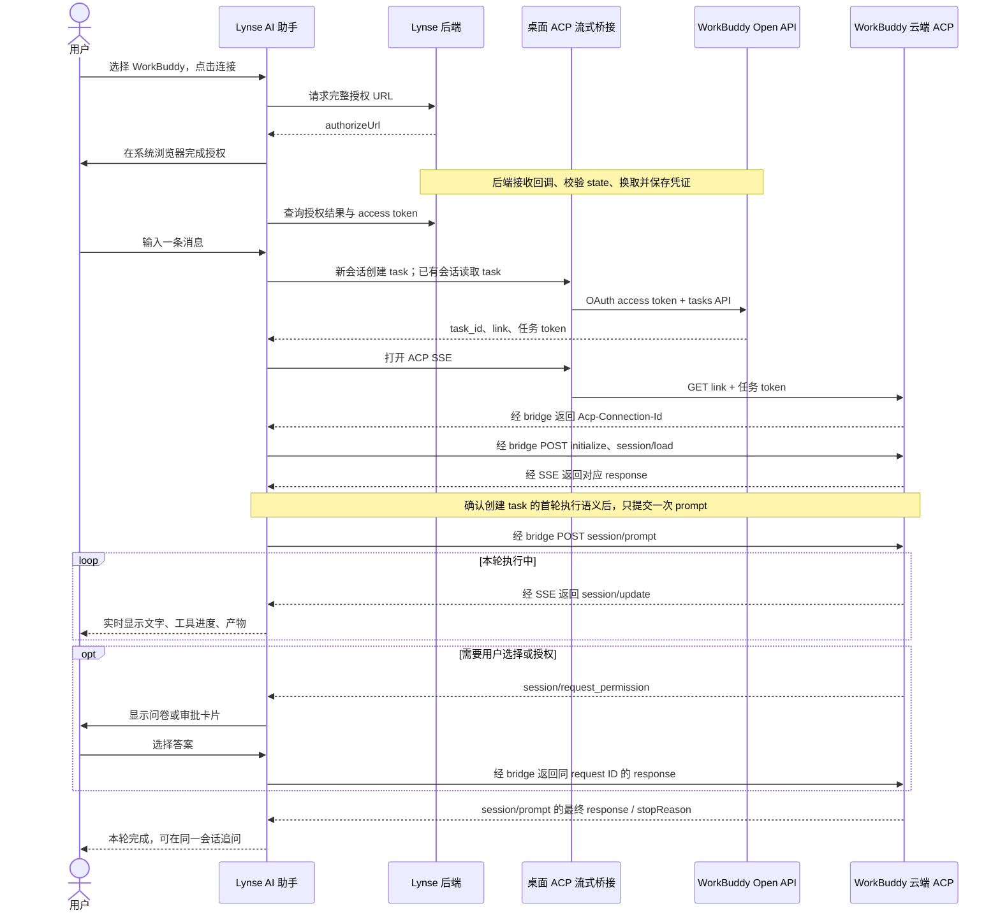

# 在 Lynse AI 助手中接入 WorkBuddy 云端对话

研究日期：2026-10-09。依据用户提供的 Open API 文档、官方文档检索、当前工作区源码及现有测试。

## 结论与建议

目标：在 Lynse AI 助手中直接与 **WorkBuddy 云端** 对话，支持独立会话、连续追问和真实流式回复。

可以通过“云端任务 API + ACP”实现。每个 Lynse 会话关联一个 WorkBuddy `task_id`，追问复用任务，ACP 的 SSE 通道推送文字和工具进度，JSON-RPC 最终 response 标记本轮结束。

桌面端云端接入代码已实现：复用助手切换、OAuth 入口、消息 UI 和 transport 接口，新增 WorkBuddy 云端 transport、ACP 协议模块与 Rust 流式桥接。Web 端仍使用已有本地助理路径。

云端沙箱的能力不能直接视为用户电脑上的能力；Lynse 的会议和笔记也需要另行设计用户选择与上下文传输方式。

模拟端到端验证已通过。真实授权问题经权限调整后已解决，用户已确认云端回复正常结束、连续追问正常；审批、产物与远端取消仍待真实场景验证。实施状态与后端核对说明见 [桌面云端接入与授权排查](workbuddy-cloud-desktop.md)。下文的既有本地问题是研究时的核对记录，不代表云端实现仍有相同问题。

## 两种路径

| 对比项 | 本地助理 | 云端任务 + ACP |
| --- | --- | --- |
| 面向谁 | 用户已连接的 WorkBuddy PC 助理 | WorkBuddy 云端任务会话 |
| 首次发送 | `POST /openapi/v2/localassistant/message` | `POST /openapi/v2/tasks` 后接入返回的 ACP 通道 |
| 获取回复 | `GET /localassistant/message?message_id=...` 增量轮询 | GET SSE 接收，POST JSON-RPC 发送 |
| 连续追问 | 复用当前用户的助理消息历史；接口没有暴露独立 session 参数 | 复用同一个 `task_id` / `sessionId` |
| 独立新会话 | 文档没有提供创建独立本地会话的接口 | 新建 task，并保存与 Lynse 会话的对应关系 |
| 结束判断 | 文档没有提供本轮结束事件；需要明确承认轮询策略的限制 | 对应 `session/prompt` 的 JSON-RPC response / `stopReason` |
| 用户交互 | `msg_type=permission_response`；`content` 内承载序列化 JSON | 响应 `session/request_permission` 的服务端请求 |
| 产物 | 消息的 `attachments` | 产物 REST 首屏 + `_codebuddy.ai/artifact` 增量通知 |
| 当前仓库 | Web 保留本地路径；桌面旧本地历史可读 | 桌面已实现 ACP；真实授权、回复结束与追问已验收 |

官方入口：[Open API 接口](https://open.workbuddy.cn/docs/openapi)、[第三方应用接入指南](https://open.workbuddy.cn/docs/third-party-app)。

## 当前可复用的实现

| 文件 | 已具备的能力 |
| --- | --- |
| `packages/views/chat/assistant-switcher.tsx` | 聊天页顶部在小灵助手和 WorkBuddy 间切换 |
| `packages/views/chat/page.tsx` | 授权提示、打开系统浏览器、发送文字、显示回复 |
| `packages/views/settings/workbuddy-config-card.tsx` | 设置中的授权入口与资料展示 |
| `packages/core/auth/workbuddy.ts` | Lynse 后端 OAuth 接口、内存 access token、刷新、Open API 请求、限流退避 |
| `packages/views/workspace/workbuddy-chat-transport.ts` | 在线检查、发送消息、增量轮询、回复映射、历史切片 |
| `packages/views/workspace/hooks/use-chat-store.ts` | 选择 transport、维护 WorkBuddy 连续对话、同步历史和去重 |
| `apps/tauri/src/tauri-bridge.ts` | 为 core 注入桌面 HTTP relay |
| `apps/tauri/src-tauri/src/workbuddy.rs` | Rust reqwest 转发 WorkBuddy Open API 请求 |

现有 `WorkBuddyChatTransport.send()` 只取文字 `query`，不会把 Lynse 的 `fileIds` 自动转成 WorkBuddy 上下文。聊天页也在 WorkBuddy 模式下关闭了笔记引用和上传入口；因此授权成功不等于 WorkBuddy 已经能读取 Lynse 的会议记录。

## 推荐的云端聊天链路

### 配置前提

1. WorkBuddy 开放平台应用已创建并处于可用状态，已获得 `clientId` 和 `clientSecret`。
2. 回调地址在 WorkBuddy 中登记；授权请求与换 token 请求的 `redirect_uri` 必须完全一致。`clientSecret` 与 `refresh_token` 由后端持有。
3. 云端对话授权至少包含 `user.task.readable` 和 `user.task.invokable`；显示昵称头像时再加 `user.profile.readable`。已经授权本地 scopes 的用户，需要明确检查云端 scopes，必要时重新授权。
4. Lynse 后端真实提供前端目前依赖的 `/api/auth/workbuddy/authorize`、`/api/auth/workbuddy/token`、`/api/auth/workbuddy/token/refresh`，以及浏览器回调处理。当前仓库只有客户端调用，不能据此确认服务端已正确配置或部署。
5. 用户完成授权，云端任务 API 可用。此路径不查询本地助理在线状态。

### 平台网络边界

本次向 `https://www.workbuddy.cn/openapi/v2/localassistant` 发送不带凭证的 OPTIONS 请求，Origin 为 `tauri://localhost`，并请求 `authorization` 请求头：返回 HTTP 404，未返回 CORS 允许头。这验证了现有 Open API 桌面 relay 的必要性，但没有验证各个云端 ACP 地址的 CORS。

Web 目前回退到直接 `fetch`，没有使用此 relay。实际 Web 域名的 CORS 策略仍需单独验证；若不被允许，应添加受认证的同源 WorkBuddy 转发接口。现有通用业务代理不会被这段直连代码自动使用。

桌面端建议新增 Rust ACP 流式桥接，用 `tauri::ipc::Channel` 逐块传输事件；Tauri 官方将 Channel 用于流式 HTTP 响应等场景。[Tauri 官方说明](https://v2.tauri.app/develop/calling-rust/)

`apps/tauri/src-tauri/Cargo.toml` 已启用 reqwest 的 stream feature，并已有 futures-util / Tokio，可使用当前依赖实现。现有 `workbuddy_openapi` 固定 Open API 域名、60 秒总超时，并等待完整 body，不能直接复用为 ACP 长连接。新增桥接须在读到响应头时立即返回 connection ID，保持流可接收，再允许 POST；不能等 SSE 完整结束才返回。

### 实施范围

| 位置 | 云端接入改动 |
| --- | --- |
| `packages/core/auth/workbuddy.ts`、`packages/core/workbuddy/api.ts` | 创建、查询 tasks 的类型化 API；token 的账号与后端隔离；脱敏授权诊断。 |
| `packages/core/workbuddy/acp.ts` | 处理跨网络 chunk 的 SSE 帧、JSON-RPC request ID、initialize/load/prompt 阶段、服务端交互请求；由平台注入网络桥接，遵守 core 的包边界。 |
| 新增 `packages/views/workspace/workbuddy-cloud-chat-transport.ts` | 实现现有 `ChatTransport`，把 ACP 事件映射到当前 content/tool/meta/done/confirm；不再用本地轮询或回复打字机模拟流。 |
| `packages/views/workspace/types.ts` | 给会话增加明确的云端 WorkBuddy 状态，例如 `workbuddySession: { mode: "cloud", taskId: string }`；增加保存任务映射的事件；不持久化任务 token。 |
| `packages/views/workspace/chat-transport.ts` | 在发送参数中传入可选 WorkBuddy 远端会话状态；首轮创建后的 taskId 通过事件尽早交给 store 保存。 |
| `packages/views/workspace/hooks/use-chat-store.ts` | 使用云端 transport；去掉 WorkBuddy 云端只有一个连续线程的假设，让清空、新建、选择历史和后台执行按具体会话工作；云端不再调用 localassistant 历史同步。 |
| `packages/views/chat/page.tsx` | 在 WorkBuddy 云端模式显示新会话和历史入口，展示真实流式进度、用户交互卡和不同结束状态。 |
| `packages/views/workspace/chat-history.ts` | 验证并保存 taskId 映射，保留只有附件的消息。旧本地历史保持可读，不自动关联到任意云端 task。 |
| `apps/tauri/src-tauri/src/workbuddy.rs`、`lib.rs`、`tauri-bridge.ts` | 注册 ACP 流式建连、POST 和关闭功能；生命周期跟随认证用户与会话，返回响应状态和 connection ID。 |
| Web 平台 | 本次未接入云端；若扩展 Web，需另行验证 CORS 或注入同源 ACP 转发。 |

`ChatConfirm` 已扩展 WorkBuddy 问卷、选项和 request ID 映射，回答由原 ACP 连接返回同 ID 的 response。AskQuestion 扩展仍需真实下行样例核对。

建议云端回合状态为 `connecting → initializing → loading → prompting → streaming / waiting_user → done / error / interrupted`。加载历史的回放与当前 prompt 的输出分开处理；权限请求期间不能标记本轮完成。断线后不自动重发 prompt，恢复策略应根据实际回放能力决定。

## 既有本地实现的核对结果

以下是研究中发现的既有问题，供复用授权、附件和历史逻辑时参考；它们不是本次云端方案需要先完成的本地功能清单。

以下区分源码中直接可见的问题和需要真实服务验证的协议假设。

| 优先级 | 发现与证据 | 建议 |
| --- | --- | --- |
| 高 | `workbuddy.ts:202,332` 使用没有用户或后端标识的模块级 token 缓存；`auth/index.ts:155` 登出流程没有清理它。切换账号或后端后可能复用上一身份的 WorkBuddy token。 | 缓存绑定当前认证身份和后端；登出、换用户、换后端时清空，并丢弃旧请求的迟到结果。 |
| 高 | transport 识别 permission metadata 后只输出“请在 WorkBuddy 应用中完成确认”，未发送 `permission_response`。这不能满足所有交互都留在 Lynse 的目标。 | 接到真实下行样例后，解析成问卷/审批卡；由用户选择后回传对应 requestId。文档明确了 AskQuestion 答案格式，工具审批的完整字段仍需确认。 |
| 高 | `workbuddy-chat-transport.ts:439-459` 在没有文字时提前 continue；附件解析在其后。因此纯附件回复在当前发送轮询中被遗漏。`chat-history.ts` 的保存过滤也未保留只有附件的助手消息。 | 在文字分支前解析附件，允许只有附件的回复，并保留附件消息的去重标识；保存历史时也保留这些消息。 |
| 高 | `workbuddy-chat-transport.ts:375` 用 4 秒无新消息判定结束；权限提示也会启动这个倒计时。 | 权限请求进入 waiting 状态，不能当完成；本地路径明确显示回复/等待状态，保留后续增量同步。不要把暂时静默等同远端任务结束。 |
| 中 | POST 返回的 `message_id` 没有被使用（transport:298）。轮询从发送前基线开始，可能把期间其他入口产生的回复并入本轮。 | 成功发送后使用返回 ID 做增量起点并记录本地用户消息；仍需承认共享消息流缺少关联 ID，不能完全隔离其他设备的同时交互。 |
| 中 | `seen.has(id)` 在内容处理前跳过已见消息（transport:428），后面的长度增长逻辑不能处理同 ID 更新。 | 向 WorkBuddy 确认消息是否只在完成后出现、是否更新同 ID。若会更新，按 ID 更新而非一次去重，并核实增量查询能否返回更新。 |
| 中 | 切换到 WorkBuddy 时的历史同步只取最新 50 条。 | 增加历史分页；等待中的交互请求也应恢复，不能只恢复普通文字。 |
| 中 | `cancel()` 只停止本地轮询，文档未列出本地助理取消任务接口。 | 产品提示应反映“停止等待/接收”的实际含义；不要声称远端操作已经取消。 |

还需处理：区分授权失效、缺少 scope、离线、限流和网络错误；发送请求结果不明时先查询历史，避免自动重发造成重复执行。

## 云端 ACP 的协议细节

在现有 `ChatTransport` 旁新增 `WorkBuddyCloudChatTransport`，复用当前聊天 UI 与消息 store；会话对应关系需要显式保存，不要把现在的单一 WorkBuddy 本地历史当云端会话。

1. 新会话调用 `POST /tasks`，保存 `task_id`。缺少 `link` / `token` 时轮询任务详情，追问复用原任务，不重复创建。
2. GET 返回的 `link` 建立 SSE，携带任务 token，并读取响应头 `Acp-Connection-Id`。此任务 token 与 OAuth access token 分开管理。
3. POST 同一 `link` 发送 JSON-RPC，并回传连接 ID；依次完成 `initialize`、`session/load`、`session/prompt`，等待每个对应的 response 后继续。
4. 将 `session/update` 映射为文字、工具活动与计划；按 JSON-RPC request ID 匹配最终 response。以 WorkBuddy 文档规定的 `session/prompt` response 结束本轮。
5. `session/request_permission` 是需要客户端回答的请求，应展示交互卡并返回同 ID 的 JSON-RPC response，不能按普通 notification 忽略。
6. ACP 请求返回 401 时通过 `GET /tasks/{task_id}` 换取新任务 token；重新建连并加载会话，不能盲目重新发送已提交的 prompt。
7. 产物先 REST 拉取全量，后按 `artifact.uri` 接收 created / updated / deleted；图片、文档等映射到当前附件 UI。
8. 确认 WorkBuddy 实际支持的取消方法后再实现远端停止。ACP 流式传输需要新增原生流通道或后端代理；现有 Rust relay 读取完整 body 且固定 Open API 域名，不能直接承担 ACP SSE。

云端所需 scopes：`user.task.readable`、`user.task.invokable`。

### 云端联调前需要澄清的文档细节

- `POST /tasks` 的 prompt 是否已经自动执行首轮？文档同时给出 working 状态和随后 `session/prompt` 的例子。必须确认，防止首轮执行两次。
- 是否严格按示例协商 `protocolVersion=1`？ACP 官方已有 v2 生命周期差异，不能把新版本 SDK 的默认行为直接套到 WorkBuddy 示例上。[ACP 官方 v2 迁移说明](https://github.com/agentclientprotocol/agent-client-protocol/blob/main/docs/protocol/v2/migration.mdx)
- 任务例子中的 `link` 为 `https://acp.workbuddy.cn/sessions/{id}`，产物说明却以“去掉 link 末尾 /acp”推导 sandbox URL。两种结构不同，应确认真实返回地址与产物访问地址，不能一律进行字符串替换。
- 下行 AskQuestion、审批 metadata 的真实结构，消息顺序、是否更新原 ID、历史分页边界和轮询频率限制。
- SSE 断线期间的文本历史如何恢复、是否支持重放；产物 REST 恢复并不等于聊天文本恢复。

## 云端交付顺序与验收

第一阶段：确认后端 OAuth 云端 scopes 与 task 首轮执行语义，实现任务创建/恢复、桌面 ACP 流式桥接、云端 transport、新会话与历史映射，跑通首轮和连续追问。

第二阶段：补齐问卷/审批、工具进度、产物、token 更新、错误分类和断线后的状态恢复，使需要用户交互的任务也能在 Lynse 中继续。

验收场景：两个独立云端会话不串消息；追问复用原 task；首轮不重复执行；SSE 分片与同一网络 chunk 多事件；initialize/load/prompt request ID 正确匹配；历史回放不当成新回复；问卷/审批回传；不同 stopReason；401/403/429；任务 token 更新；纯附件回复；切换账号丢弃旧事件；断线不重复提交；重启后恢复映射；远端停止能力按实际支持验证。Lynse 笔记内容需要单独设计用户选择和传输方式，不默认发送。

研究阶段已执行：

- `pnpm --filter @lynse/core exec vitest run auth/workbuddy.test.ts`：15 项通过。
- `pnpm --filter @lynse/views exec vitest run workspace/workbuddy-chat-transport.test.ts workspace/hooks/use-chat-store.test.ts workspace/chat-history.test.ts`：35 项通过。
- `pnpm --filter @lynse/core typecheck`、`pnpm --filter @lynse/views typecheck`：通过。
- 不带凭证的桌面 Origin CORS 预检：HTTP 404，未返回 CORS 允许头。

上述是研究阶段记录。实施后的测试与真实授权阻塞见 [桌面云端接入与授权排查](workbuddy-cloud-desktop.md)；未执行旧的真实本地助理消息测试。
