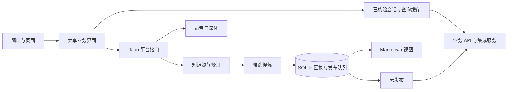

# Lynse Desktop 全仓架构审查与重构

## 范围与验收

以当前 Lynse Desktop 工作区为基线，沿桌面、Web、共享界面、数据层、Tauri/Rust、集成 BFF 和发布检查逐层追踪。范围也包括录音 sidecar、问题反馈入口和部署配置的接口审查。工作区原有的反馈迁移、纪要门槛和版本改动继续随当前代码保留。Lynclaw 服务只用于核对会议发布契约。

- **启动与导航**　登录、首页和独立窗口只加载本入口所需代码。录音切换保留页面内反馈，低频页面和设置打开时显示各自内容。
- **账号与笔记**　切换账号或服务器时停止沿用旧会话请求与缓存。笔记列表、本地录音和云待办保留原有来源和操作。聊天草稿在身份核验期间可以继续编辑。
- **录音与播放**　保留本机录音、云音频下载、缓存复用、进度和波形。播放跳转读取对应字节范围，访问加密灵感仍需媒体凭证。
- **知识整理**　已完成的会议输入跳过模型调用。提炼、Markdown 写入和云发布支持各自恢复。权限或源修订发生变化时，落库和发送应以当前状态为准。

## 分层审查

| 用户流程与代码层 | 原设计的问题 | 落地处理与取舍 |
| --- | --- | --- |
| 启动、登录、录音浮窗、设置 | 主入口同步导入登录后页面，包聚合入口还把页面级依赖带入全局初始化。窗口最大化状态有多个监听。 | 主窗口分为引导、登录和工作区，独立窗口及低频页面按需载入。设置首次打开才加载实现，后续重开保留状态。最大化状态每个 WebView 共享一个原生订阅。[启动入口](../apps/tauri/src/main.tsx) · [应用外壳](../apps/tauri/src/App.tsx) · [工作区](../apps/tauri/src/Dashboard.tsx) |
| 登录、切换账号、恢复会话 | 过期请求的响应可以晚于新登录。只清磁盘镜像会留下内存查询，延迟写入还可能把旧内容重新落盘。桌面登出还有一条重复的 Keychain 整体写路径。 | API 以会话修订检查返回值与错误。登录和登出清查询与列表镜像，列表落盘只响应相关更新。凭据删除沿用平台适配器原有的原子更新。[API 客户端](../packages/core/api/client.ts) · [认证](../packages/core/auth/index.ts) · [缓存](../packages/core/query-persistence.ts) |
| 会议、笔记、文件、待办 | 列表有多份相同的解析逻辑，参数差异会拆出重复缓存，云数据会等待本地 IPC 返回。待办启动镜像混入账号数据。 | 会议列表统一为一次合并，缓存键对应实际请求，本地和云端并行读取。待办磁盘镜像只保留设备待办，账号待办从当前会话加载。[文件查询](../packages/views/workspace/hooks/use-files.ts) · [待办数据](../packages/views/todo/todo-api.ts) · [待办状态](../packages/views/todo/use-todos.ts) |
| 聊天、笔记选区和上下文通知 | 页面、笔记工具栏和通知分别绑定聊天账号。首次发送可能先写进共享历史，随后被已核验账号覆盖。侧栏把所有回复都标成正在流式输出。 | 应用认证边界统一切换账号，两个工具栏共用选区发送。旧版无归属历史继续存放于原键，由于缺少可验证的所有者，登录后只打开账号历史。复用已完成回复的 Markdown 渲染。[会话绑定](../packages/views/workspace/hooks/use-chat.ts) · [历史](../packages/views/workspace/chat-history.ts) · [回复正文](../packages/views/chat/chat-reply-body.tsx) |
| 音频回放、转写结果、波形 | `lib.rs` 同时注册 IPC、解析媒体 ID、读取字节和计算波形。云音频缓存未命中时，多次请求容易重复下载或排在同一全局锁后。 | 本地媒体模块收口 ID、文件授权和 Range 处理。云下载按账号、文件和版本去重，独立音频共享连接池与三条传输槽。完整文件原子进入缓存。录音采集、ASR sidecar 和签名入口继续走原路径。[媒体协议](../apps/tauri/src-tauri/src/local_media.rs) · [云音频](../apps/tauri/src-tauri/src/cloud_audio.rs) |
| 知识库阅读、提炼与发布 | 单篇读取和重新生成曾先构建全库 AI 范围。候选任务周期性读取全量正文，发布遇到源文不匹配时会删除提炼结果。 | 单篇命令检查目标源。候选调度先比对源修订，按模型与实际证据复用结果。提炼、发布独立推进，发布失败在队列里处理，保留已完成的提炼回执。[调度与阅读](../apps/tauri/src-tauri/src/workbench/mod.rs) · [提炼](../apps/tauri/src-tauri/src/workbench/meeting_candidates.rs) · [发布](../apps/tauri/src-tauri/src/workbench/meeting_candidate_publication.rs) |
| Web 与外部集成 | Web 代理先把上传读进内存，集成服务的并发鉴权会为同一令牌多次回源。 | 双向流式代理传递取消与正确的响应头。同令牌并发共享验证，服务端返回的主体才能进入缓存。[Web 代理](../apps/web/app/api/proxy/%5B...path%5D/route.ts) · [集成身份](../services/integrations-bff/src/identity.mjs) |
| 工程检查和反馈 | 根类型检查漏掉桌面 renderer。国际化审计使用独立资源清单，随应用扩展发生漂移。更新 UI 测试读取不存在的发布版本文件。 | 桌面进入根类型检查。国际化读实际注册资源。更新测试直接提供多语言模拟数据。问题报告沿用现有 CloudBase → CNB 入口与工作区反馈迁移。[桌面脚本](../apps/tauri/package.json) · [国际化审计](../scripts/i18n-audit.mjs) · [更新测试](../e2e/tests-desktop/10-update-details.spec.ts) |

## 数据与后台设计

前台路由只拥有交互状态。TanStack Query 管理可重取的服务端读模型，Zustand 管理编辑草稿、聊天流和选择状态。账号切换是两者共享的生命周期事件。浏览器和 Tauri 通过各自适配器获得同一业务接口，原生任务和密钥由 Rust 持有。

候选流程中，**源修订决定是否需要重新读正文，证据文本与模型身份决定是否需要重新提炼**。已匹配的旧 v3 回执可原地接续。转写、标题等字段更新时，如果选择的纪要证据未变，更新引用修订即可。提炼产生的条目、提炼回执和待发布任务在一个 SQLite 事务提交。Markdown 导出支持重试，遇到外部编辑时保留用户文件并写入 `.incoming.md`。

发布端从队列取当前源修订，使用已核验的服务端写者和固定请求体。连接中断时重放同一请求。服务端明确拒绝后可重新协商版本或延后该条发布。源文暂不可用或指纹不一致时保留提炼回执。新提炼已经替换原任务时，旧请求的响应无法结算新任务。

## 可复测结果

使用同一 checkout 前后两次 `vite build --manifest` 的产物。遍历入口的静态 `imports`，去重累加 JS 文件，gzip 按文件独立压缩并累加。数据衡量构建体积，单位为十进制 MB。

| 桌面加载范围 | 重构前原始 / gzip | 重构后原始 / gzip |
| --- | ---: | ---: |
| 启动脚本及其静态依赖 | 5.059 / 2.030 MB | 0.460 / 0.145 MB |
| 进入登录外壳的累计依赖 | 5.059 / 2.030 MB | 2.177 / 1.031 MB |
| 继续进入登录后工作区外壳的累计依赖 | 5.059 / 2.030 MB | 4.561 / 1.911 MB |

桌面端与 Web 端默认使用系统字体。移除 OPPO Sans 字体资源，构建产物少一份 13.64 MB 的 WOFF2 文件。字体文件体积单独计量。

- **前端**　Vitest 1,084 通过，1 条真实后端用例跳过。60 段聊天回放中，旧回复正文无额外渲染，刚完成的回复渲染 1 次。全仓类型检查、Lint 和国际化审计通过，Lint 有 16 条警告。
- **Rust 与服务**　Rust 库测试 555 通过、7 忽略。覆盖源修订命中时跳过正文读取、候选事务回滚、旧发布回执隔离、传输范围与恢复。集成 BFF 20 通过，8 个并发同令牌请求只回源验证 1 次。macOS 录音 DSP 合成音频自测通过。
- **端到端**　Web 生产构建 38 条模拟流程通过。桌面渲染器 90 条功能用例通过，包含 4 条模拟第三方连接用例和 1 条知识库回环用例。知识库回环另外通过 2 条 Rust 用例，覆盖 Lynclaw 合成服务、原生校验、落库到界面。截图基线、正式账号与云服务、系统录音、签名安装以及 Windows 原生行为另需对应环境验证。

## 剩余架构工作

1. **公开 Web 代理的目标授权**　部署配置把 `/app/` 暴露给浏览器，代理仍接受请求方提供的 HTTP(S) 目标。现有助手设置允许自定义地址。固定环境的服务端目标配置，以及自托管地址的信任与出口边界，需要一并确定。流式改造保留了现有目标选择。
2. **工作区详情的状态所有权**　`content-panel.tsx` 仍约 2,371 行，同时持有编辑器、转写、音频、总结和上传状态。按文件 ID 建立一个详情生命周期，把播放器、正文与总结保存各自现有入口下移。切换笔记、重试、保存与播放是拆分后的验收依据。现有查询键和编辑器草稿是可复用接口。
3. **知识库大数据量路径**　单篇操作与候选规划已减少正文扫描。`wiki_automation::ai_manifest` 仍会为了跨库搜索或上下文读取整库源记录并计算授权。将文件夹、修订和范围字段落入已有索引后，可先筛候选，再对被读取的证据做实时授权复核。云发布历史游标和撤回联动需要与 Lynclaw 服务协作。当前工作区只验证了桌面侧提交与恢复。
4. **应用壳体积和原生生命周期**　登录后工作区仍有约 1.91 MB 压缩 JS。`lib.rs` 仍有约 6,177 行，可继续沿录音会话、文件导入和窗口命令拆出入口，并用 macOS 与 Windows 实机回归保护现有生命周期。
