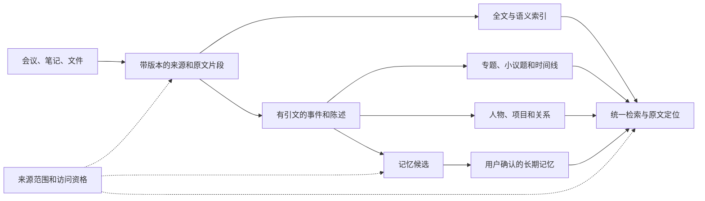

# Lynse 知识库目标架构

2026-11-14 · 新版知识库 · [需求](requirements.md) · [实施与验收](tasks.md)

## 架构决策

**将 Lynse 重构为以原始证据为底座的会议知识库。** 用户能从搜索直接找回一段原话，从项目专题连续看进展和决策，也能让助手在同一授权范围内回答问题。会议转写、纪要、笔记和文档是可引用的来源。专题正文、时间线和图谱从带出处的结构化内容生成。个人记忆沿用独立的确认和遗忘生命周期。

桌面私有资料由 Tauri 和 SQLite 管理。账号范围内已授权同步的内容由既有 Lynclaw 鉴权网关和 `lynse-memory` 的 PostgreSQL 服务管理共享权限、版本与发布。两端采用相同的来源、证据、变更及检索契约。目标是按变化处理内容、按权限发布内容，并让产品可以独立替换解析器、检索器和模型。

## WeKnora 的架构参考

| 能力 | WeKnora | Lynse 的设计取舍 |
| --- | --- | --- |
| 入库与来源 | 入库先落库，再由后台解析、分块、索引并做 Wiki 等后处理。文件、外部数据源有各自的接入流程。 [入库流程](https://github.com/Tencent/WeKnora/blob/main/website-docs/02-architecture/03-document-pipeline.md) · [数据源](https://github.com/Tencent/WeKnora/blob/main/website-docs/03-features/10-datasource.md) | 采用来源适配器和分阶段就绪。会议适配器复用现有纪要、时间戳和录音定位，文件、笔记及后续连接器接入同一来源协议。 |
| Wiki | 按文档分块提取实体、概念和引文，随后按页面标识合并。同页能合并一批来源变化。当前 `main` 的已有实体和概念页更新仍把整页正文交给模型，接收完整正文并写回。 [Wiki 生成](https://github.com/Tencent/WeKnora/blob/main/website-docs/03-features/14-wiki.md#生成流程) · [页面写入源码](https://github.com/Tencent/WeKnora/blob/main/internal/application/service/wiki_ingest_batch.go#L2197-L2230) · [大页面重写案例](https://github.com/Tencent/WeKnora/issues/4016) | 沿用“来源增量 → 定位受影响页面”，把可替换的单元细化到来源贡献和页面小节。沿用 Lynse 的稳定分块与证据校验方式。 [现有约定](../../docs/knowledge-wiki-incremental.md) |
| 检索与问答 | 关键词和向量混合召回，支持重排、上下文扩展，以及先找 Wiki、再读原文的 Agent 工具。 [RAG 流程](https://github.com/Tencent/WeKnora/blob/main/website-docs/02-architecture/04-rag-pipeline.md) · [Wiki 工具](https://github.com/Tencent/WeKnora/blob/main/website-docs/03-features/14-wiki.md) | 桌面搜索、问答准备和 MCP 从同一入口使用 FTS5、段落向量与 RRF 融合。重排和图谱召回以问答评测决定。 [桌面搜索](../../apps/tauri/src-tauri/src/workbench/mod.rs#L1022) · [聊天上下文](../../apps/tauri/src-tauri/src/workbench/mod.rs#L1617) · [段落向量](../../apps/tauri/src-tauri/src/workbench/wiki.rs) |
| 图谱 | GraphRAG 可由查询实体定位邻居及关系，再取关联分块补充召回。 [知识图谱](https://github.com/Tencent/WeKnora/blob/main/website-docs/03-features/09-knowledge-graph.md) | 图谱节点和边从带出处的陈述、专题归属及人工合并派生。默认按需加载局部图，关系问题可沿边找证据。复用现有图谱的证据和人工映射，优先使用同库索引及连接表。 [现有图谱协议](../../docs/knowledge-graph-optimization.md) |
| 权限与记忆 | 知识库共享及对话范围控制独立于个人长期记忆，自动记忆支持用户确认。 [Agent 资料范围](https://github.com/Tencent/WeKnora/blob/main/website-docs/03-features/07-agent.md) · [长期记忆](https://github.com/Tencent/WeKnora/blob/main/website-docs/03-features/23-memory.md) | 复用 Lynse 已有来源授权、分项同意、候选审阅、遗忘和回执重放校验。专题事实可用于当次已授权的检索，长期记忆只读取符合资格的已确认记录。 [现有记忆契约](../knowledge-memory/plan-v0.4.md) |
| 部署 | 标准版侧重共享空间和服务端部署，Lite 侧重单空间和本地运行。 [总体架构](https://github.com/Tencent/WeKnora/blob/main/website-docs/02-architecture/01-overview.md) · [Lite 对比](https://github.com/Tencent/WeKnora/blob/main/docs/LITE.md) | 以 Lynse 的账号与桌面为集成边界。整套采用标准版需要重接会议回放、既有授权、记忆和跨设备协议。Lite 可做本地对照组。独立模块能通过统一证据接口接入，并以实测结果决定采用。 |

## 实现选型

| 路线 | 能直接获得的能力 | 决定因素 |
| --- | --- | --- |
| 将 WeKnora 标准版作为知识服务 | 文档解析、外部连接器、共享空间、混合检索、Wiki 和管理面板 | 需要迁移资料标识并接通 Lynse 来源授权、撤销、录音定位、人工归组、双设备同步和长期记忆。已有实体页更新仍需要整页生成。适合用作同批授权资料的能力对照。 |
| 将 WeKnora Lite 接到桌面 | 单应用运行、SQLite 检索、文档导入和本地 Wiki | 需要为每个 Lynse 账号管理进程与数据边界，并衔接现有同步和权限。Lite 的本地检索与解析可独立比较，整套接入仍需实现会议引用和共享发布。 |
| 重构 Lynse 知识内核 | 保留现有会议、授权和用户操作契约。在一套证据上做段落检索、小节更新和独立记忆确认 | **推荐路线。** 主要工作是对齐来源与页面依赖，统一模型任务和账号写权。WeKnora 的连接器、解析器或检索模块可以通过同一来源与证据契约独立验证，达到验收门槛后采用。 |

## 来源、证据与派生内容

| 数据 | 稳定身份与版本规则 |
| --- | --- |
| 来源及表示 | 以知识库、连接器、外部 ID 确定来源身份，沿用已存在的会议等 ID。纪要、转写、人工笔记各自保存有效正文版本。目录、标签、录音位置和授权独立变更。 |
| 原文片段及引用 | 以来源、表示和稳定片段 ID 定位，记录正文哈希和实际片段顺序。引用保存版本、精确原句和定位信息。文本相同时可重绑元数据，经同一权限和逐字匹配校验。 |
| 来源贡献 | 为每条有证据的事件、陈述或关系保存规范语义、陈述状态、日期与引用集。按议题、来源表示和片段反向查找。多个来源独立举证，同一来源重试按操作 ID 覆盖同一贡献。明确区分事件发生日、会议时间与入库时间。 |
| 专题及页面 | 大专题与小议题使用稳定 ID，允许显示别名及合并重定向。段落依赖可追溯的贡献，页面版本和人工操作有前序版本。正文、时间线、图谱、导出 Markdown 均由结构化数据派生，外部 Markdown 编辑以带基准修订的人工操作导入。 |
| 任务与变更 | 来源提交在同一事务写变更记录。索引、抽取、议题匹配、视图发布分别持有完成回执。每个任务记录稳定的逻辑 ID、输入版本、当前尝试和结果。对外同步事件随发布事务写入持久队列。按阶段查看积压、最旧等待时间、进度和失败原因。 |

用两套身份描述模型执行。业务上的完成状态以有效证据、处理规则、语言及用途为准。执行尝试记录选用的模型、提供方、提示词和契约版本，用于校验、诊断和回执。切换写作模型只改变后续请求的路由。图谱可继续使用现有独立的模型配置，逐步采用能通过证据与覆盖度验证的共用抽取结果。语义向量单独按嵌入模型和维度版本维护，词法索引、正文和分组可继续服务。处理契约发生实质变化时，仅重新处理受影响的派生产物。

## 入库与专题更新

1. 连接器返回来源身份、独立修订及删除状态。提交时使用规范化正文指纹跳过重复取得的内容，并在提交成功后推进同步游标。空页、临时失败和明确删除分别处理。排除、撤销和遗忘用立即生效的记录阻断读取。处理积压时按来源合并未开始的修订，校验删除记录和当前授权版本后领取任务。
2. 用已有稳定分块对齐未变的片段。会议提取以有完整内容的纪要为入口。纪要的引文标记为纪要，原话、发言人、精确时间、遗漏及冲突都回到转写。可证明信息充分的情况下复用已校验的抽取结果。以测试集确认这种共用能维持 Wiki、图谱和记忆的各自覆盖度。
3. 针对一段变化的内容抽取一次，共用经校验的事件与陈述。通过别名、项目上下文和全文或向量召回找可能的已有议题，再用来源证据确认关联。用户明确归组、合并、排除的决定优先。自动归组以实际归属输入变更为触发条件。
4. 按来源更新对应贡献，确定性重算时间线、来源清单、引用和目录。模型需要写作时，只返回变动的小节及其引用编号，程序按稳定小节标识提交。主页的短概览按变更合并后刷新，输入与输出均有固定预算。历史很多的项目可以分议题或时段浏览。
5. 删除来源时先撤销资格，再查反向依赖删除该来源的贡献。还有其他有效证据的陈述继续进入相关视图。历史版本的引用按当前渠道的来源权限校验。新证据与人工编辑冲突时，记录双方证据并生成候选差异。

举例，硬件大专题已有十场会议，新会只补充“防水验证”小议题。新会入库后全文可搜。整理产出一条带时间和出处的验证决定，更新这条时间线、小议题及相应图谱边。项目概览有实质变化时再合并更新。若原话只是提议，页面显示为提议，原已确认结论的更新进入候选。

## 检索与产品入口

知识库首页支持搜资料和打开项目专题。来源页展示正文及录音定位，专题页展示概览、议题、时间线和证据，图谱由用户按项目或人物展开。助手与 MCP 通过同一检索契约获得证据，问答先用专题定位，再取当前有权访问的原文片段；有时间范围的查询可以直接按会议和事件时间过滤。文本检索就绪、整理进度、等待转写、失败原因和受影响的资料单独显示。

检索接口返回 `passageId`、`sourceId`、`revision`、`locator`、可选 `topicId` 和命中原因。Desktop 使用现有 SQLite FTS5 和可选片段向量。账号资料端在现有 PostgreSQL 服务中实现带租户与范围过滤的查找，中文分词以现有召回和实测为基线。首次实现用片段级 RRF 融合，同源去重在段落命中后进行。向量或重排超过查询时限时返回可用的关键词结果。重排、关键词扩展和图谱补召回各自通过代表性问题的对照测试后启用。模型得到的证据按当前权限和预算组装，回答的引用由编号解析回原始来源。

## 本地与共享边界

- **设备私有知识库**由该设备记录内容版本、索引、任务和页面 head。复用现有本地会议文件储存与来源恢复逻辑。SQLite 对结构化依赖、任务和发布建立事务边界，Markdown 与原文文件的跨存储提交继续用可恢复的意图日志。凭据由现有系统密钥管理提供。
- **账号同步知识库**由云端记录共享的 head、授权版本、人工操作与删除记录。每个计算任务同时只有一个有提交权的执行者。云端有权访问来源和模型时，可由现有后台队列执行。仅设备持有资料或模型凭据时，由具备资格的设备领取、计算并提交允许同步的产物。不同模型设置的设备按证据与协议版本采用同一份结果。同步采用增量游标及基于预期版本的条件提交，冲突保留分支等待合并。发布权参考 `lynse-memory` 中已有的会议发布设备代次，Wiki 任务拥有独立的领取和发布记录。
- **任何读写入口**应用当前账号、来源权限和本地否决条件。检索候选、向外部模型提交、发布和结果重放均复核来源资格，包含向量与重排请求实际使用的内容。工作区或文件夹移动触发资格校验。撤销优先更新授权版本再异步清理，延迟任务无法覆盖撤销记录。账号授权无法确认时暂停相关 AI 读取与外发，本机私有资料按本地策略使用。
- **记忆**只接收结构化候选与必要来源指针，复用现有 `lynse-memory` 确认记录、人工纠正和遗忘。关联会议资料的记忆应继续遵循原来源限制。待办及人工判断由现有业务模块管理。

共享协议提供可恢复的写入回执与退避。对模型可能已受理但结果未知的直连请求，持久化原尝试并等待可查结果或用户显式重试。 [现有任务账本约定](../../docs/knowledge-wiki-incremental.md#模型任务状态与重启)

## 新版启用与实现边界

按当前授予的范围建立原文索引和专题，新协议的同步载荷是 `wiki-topic-v2`。原始会议仍使用现有来源和回放入口。完成身份由内容、语言与处理协议决定。跨设备先尝试识别并收养当前来源内容一致的新版页面和目录缓存，写入携带预期页面哈希、授权版本及范围版本。服务端保护发布版本及删除记录。

本地 Wiki 更新按来源和受限分块写作，再用程序拼装页面。全文段落保留稳定的命中定位，语义向量独立维护。Web 对已授权的账号资料融合关键词和段落向量，向量按来源修订和模型校验，通过现有后台 worker 生成。部署启用语义召回需要配置 `LYNSE_MEMORY_EMBEDDING=tokenhub` 并运行新版 context worker。桌面复用现有图谱和独立的记忆确认链路。

桌面提供专题冲突比较和编辑合并。客户端以最后确认的共同稿为基准，能判定互不重叠时提供合并建议。用户确认后，版本历史保留本机与云端原稿，云端写入以刚比较过的版本为条件。

待完成的实现包括对外连接器统一接入、专题与图谱共用结构化证据及共享 Wiki 计算任务领取。质量和响应时间使用同一批资料实测。 [实施与验收](tasks.md)
